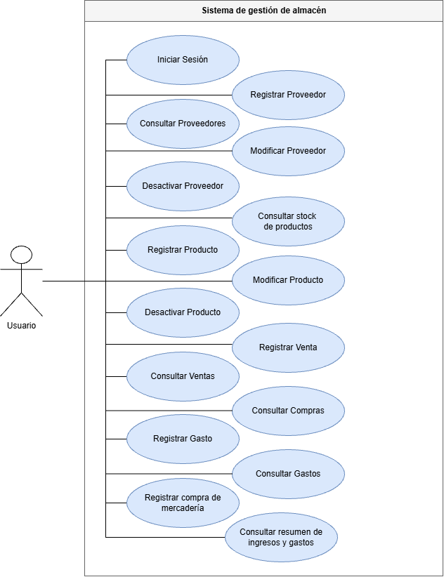
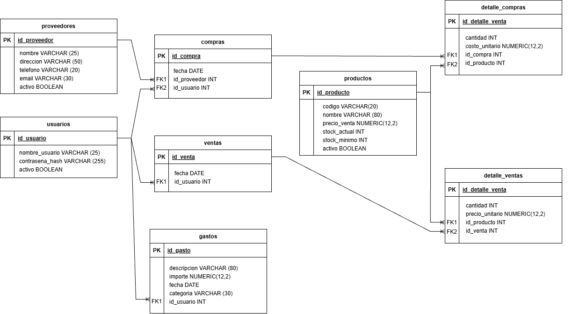

# Diagramas del sistema

## Diagrama de casos de uso

El diagrama de casos de uso incluido en el informe original se conserva en `diagrama-casos-de-uso.png`.

## Diagrama de entidad-relación

El diagrama de entidad-relación incluido en el informe original se conserva en `diagrama-entidad-relacion.png`.

